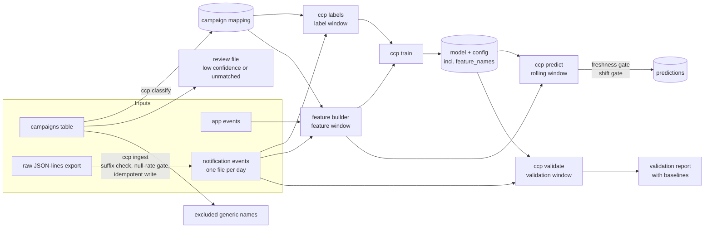

# Architecture

## Overview

A batch pipeline in two modes that share the same feature code:

- **Training (occasional):** classify campaigns, build labels, build features, train, validate.
- **Scoring (daily):** gate on fresh data, rebuild features over a rolling window, score every user,
  gate on distribution shift, publish atomically.

## Modules

| Module | Responsibility |
|---|---|
| `ccp/config.py` | Load YAML, validate windows (feature window must end before label window) |
| `ccp/classify.py` | Generic filter, keyword cascade, optional semantic fallback, overrides, review file |
| `ccp/labels.py` | Dominant clicked category per user, deterministic tie-break |
| `ccp/features.py` | App, notification, and per-category exposure features; schema checks |
| `ccp/train.py` | Split, class-count guard, LightGBM training, metrics with baselines |
| `ccp/predict.py` | Load model, verify feature order, top-2 output, distribution-shift check |
| `ccp/validate.py` | Forward validation reported next to the majority-class baseline |
| `ccp/ingest.py` | Parse raw lines, null-rate gate, idempotent per-day write, freshness gate |
| `ccp/cli.py` | `python -m ccp <command>` |

## Data flow rules

1. **Windows never overlap.** Features are built from the feature window, labels from the next one.
2. **Lifetime flags are bounded** at the feature-window end, so they cannot see later events.
3. **One classifier** serves training and scoring. Names dropped as generic are recorded and are
   not re-added later.
4. **The model config stores `feature_names`.** Scoring refuses to run if columns differ.
5. **Outputs are written to a temp file and renamed**, so a failed run never leaves a partial file.

## Failure behaviour

| Situation | Behaviour |
|---|---|
| Yesterday's events missing | `predict` fails (freshness gate) and keeps the previous output |
| Raw file in the wrong format | `ingest` fails (suffix check, then null-rate gate) |
| A day is ingested twice | The day's file is replaced, not duplicated |
| Category shares move >10 points | `predict` fails unless `--force` is passed |
| Feature columns differ from training | `predict` fails, naming the missing column |
| A category has too few rows | `train` fails with the class counts |
